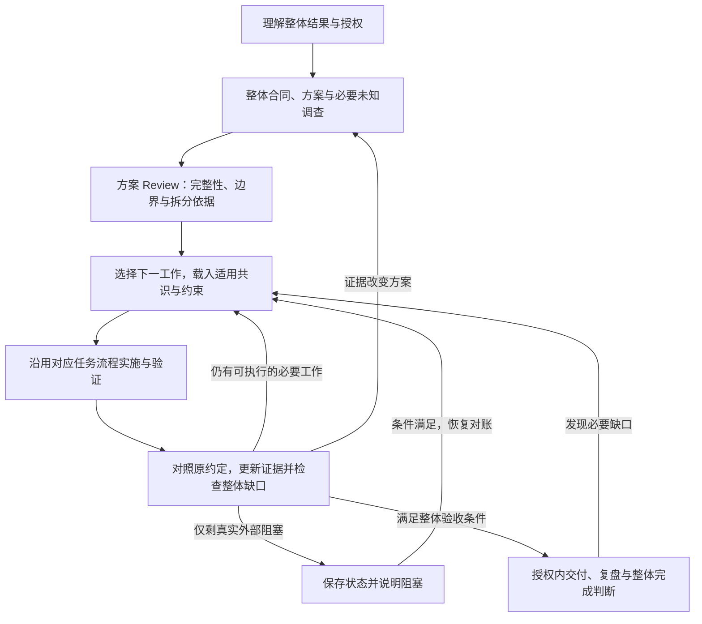

# 低监督大型交付模式设计

状态：已通过设计审查，并于 2026-09-25 完成本地规则落地与 NextClaw 接入，进入试用；官网尚未发布此更新。

本批后续恢复协议完善的执行入口：[当前状态](../work/2026-09-25-major-delivery-integration/current-state.md)。

来源：[讨论与用户预期](../thoughts/2026-09-25-low-supervision-major-delivery.thought.md)。`design-document: required`；用户后续授权在 nextbot 同步实施，结果见[本地落地记录](../logs/2026-09-25-major-delivery/README.md)。本批路径明确、一次闭合，不另建执行 plan。本文维护有效设计，效果仍需真实委托验证。

本轮过度设计审查后的边界：保留整体合同、既有设计、当前工作记录和启动即写的持续日志；取消每执行单元必建过程文件、递增编号、普遍五段填表以及重定义原设计章节。过程默认直接写日志，详情和 plan 按需要拆出。文件更新由信息变化触发，普通进展不要求同步改全套文档。

## 1. 要解决的问题与成功标准

用户把整个产品、现有项目中的大型功能或一片完整能力交给 AI，希望 AI 自主完成从理解到整体交付的工作，尽量减少日常人工介入，并获得高完成度、高质量的结果。

暂用名称为**大型交付**，英文内部标识采用 `major-delivery`；不依赖项目管理工具中 Initiative 的特定层级。这里的“大型”指整体责任需要跨工作项持续维护，不能通过文件数、工时或任务数机械判断。

现有体系已经具有三种任务流程、整体 `parent-goal`、验收账本、返工与恢复记录。需要补强的假设是：AI 在工作项之间持续维护整体成果、选择下一步并检查集成缺口的机制不够明确。该假设尚未经过真实失败案例验证。

用户补充了另一个反复遇到的问题：前期讨论中表达的预期和形成的共识，在后续实现时发生漂移。用户提出两种可能原因：未持久化导致压缩后丢失；已经写成文档，但执行时没有主动读取和核对。需要保护的不仅是功能范围，还包括用户表达的体验、架构取舍和行为边界。已有验收方法包含漂移控制，本设计进一步明确从讨论来源到执行检查的连接；具体失效原因仍待案例验证。

成功标准：

- 整体用户结果成立，必要范围没有被自行降成 MVP、演示版或“以后优化”。
- 代表性用户链路、架构约束、体验与适用的异常恢复达到事先明确的质量标准。
- AI 自主选择下一步、发现整体缺口并返工，用户无需反复提醒“继续”和“还有这一块”。
- 中断后可依据当前合同和证据恢复，过程产物可追踪、可 Review、可复盘。
- 前期预期与共识能追溯到来源，后续设计与产物主动对照；调整有依据、有记录，并遵守原有决策权限。
- 新增流程的组织成本可控：不强制增加阶段、代理、审批或每任务一套文档。

## 2. 用户如何使用

前提：项目已接入 DevWeave，宿主能读取规则、操作项目，并具备完成该委托所需的执行能力。新增模式沿用当前 AI 对话入口。

1. 用户说：“把这个项目里的 Personal Agent 完整做出来，按这些使用场景验收，尽量自主推进。”AI 结合项目事实整理整体结果、必要约束、未知和授权，并将讨论中的预期及共识保留到现有合同或设计中，向用户简明展示自己的理解。明确要求直接生效；AI 推断单独标识，不以用户未反驳视为确认。能从上下文确定的内容直接采用；影响结果的真实歧义才向用户澄清。
2. AI 给出简明的整体方案、完成判定及交付入口。用户没有要求先审方案且已有执行授权时，AI 完成内部方案 Review 后继续；用户明确要求先审时，停在约定产物。
3. AI 在同一委托下完成具体工作、持续集成和修正。进展反馈说明已证明的结果、当前关键缺口及下一步。完成一个工作项或阶段后不请求“是否继续”。
4. 用户中途补充或纠偏，AI 判断是范围内澄清、范围变更还是暂停，更新对应合同并使受影响的证据失效，保留其它有效工作。用户明确暂停时保存恢复入口并停止。
5. AI 交付可用入口、已验证结果与证据，以及适用的主观验收项。用户可直接使用或反馈；反馈中的必要缺口进入同一委托返工。约定必须用户确认时，明确保持待验收。

宿主被关闭或执行被中断时，恢复依赖宿主已有的继续运行能力或用户重新唤起；本方案提供可恢复状态。普通 Markdown 和 Skill 本身无法保证后台唤醒，不将这种能力宣传为已经存在。

## 3. 推荐结构：同一个生命周期，增加交付组织方式

| 方案 | 优点 | 主要代价与结论 |
| --- | --- | --- |
| 仅扩充验收清单 | 改动最少，复用现有账本 | 对“下一步做什么、任务结束后如何继续”的约束仍然隐含；适合单任务，不足以覆盖本次诉求 |
| **在现有 lifecycle 内增加大型交付模式** | 整体完成 owner 唯一；任务流程、验收、恢复直接复用 | 需要明确整体与工作项的状态边界；推荐首版采用 |
| 独立大型交付编排器或新 Meta Skill | 将来可支持运行队列、分布式执行与调度 | 当前没有这些运行需求的验证依据；会重复生命周期与状态，首版不采用 |

概念上区分两个维度：

- **交付组织方式**：普通任务 / 大型交付。用于判断是否需要持续维护整体合同与跨工作项推进。
- **具体工作的 flow**：`standard` / `trivial` / `bugfix`。沿用原分类、阶段门和风险判断。

大型交付中修一个局部 bug 仍走 bugfix。仅要求设计、调查或 Review 的委托仍止于对应产物。大型交付不自动获得提交、推送、部署、扩大范围或使用子代理的授权。

首版将模式作为工作记录中的流程判断，不新增 observer phase、公开运行时枚举、CLI 命令或顶层 Skill。`development-lifecycle` 保持唯一编排与整体完成 owner，新增一个按需加载的 reference 承载大型交付方法。

**进入依据：**用户委托完整的大型成果，且调查显示需要协调多个工作项、持续处理会影响后续方案的未知，或跨轮维护整体质量与交付状态。记录一条具体理由；单任务流程已能可靠闭合时直接使用。规模判断变化时可以调整模式，保留原合同、授权和有效证据。

## 4. 默认一次完整交付，按证据决定是否分阶段

三个概念必须分清：

- **开发环节**：理解、设计、Review、实现、验证、交付、复盘。
- **工作项**：为整体成果处理的一块具体问题；只有有用的实现、验证或恢复边界才拆出。它不等于新对话或子代理。
- **交付阶段**：确有必要时，为组织整体推进划出的结果边界。一阶段可以包含多个工作项，也可以跨上下文执行。

**默认将当前可一起完成、集成与验收的必要工作放在同一交付阶段。**文件多、模块多、时间长、需要 plan 或多次会话，都不能单独证明应该分阶段。可以先打通一条链路、再逐步补齐，仍在同一阶段内完成。

新增阶段边界时必须记录以下四点：

1. 边界两侧分别完成什么可观察结果。
2. 后续工作具体依赖什么前置证据、外部条件或风险隔离。
3. 合并执行会产生什么具体问题，以及为什么普通任务排序、提前集成或定向验证不足以解决。
4. 通过条件、未通过时的返工动作、通过后立即可做的下一步。

可成立的理由包括：实验结论会改变后续设计；迁移必须先满足真实兼容或观察条件；独立验证边界能隔离明确的高影响风险。普通代码依赖可以通过排序解决时，不必升为阶段。

方案 Review 做一次**合并审查**：逐个检查相邻阶段合并是否产生上述具体问题。没有充分依据则合并。也检查是否把确实未知的前提当作已成立，避免为了追求一阶段而盲目展开后续工作。新证据消除边界后允许继续合并；不设理想阶段数。

阶段门属于 AI 自检，默认通过后自动继续。只有合同明确需要用户决定或真实外部条件未满足时等待。阶段成果发布与否另按真实交付需求和授权判断，不要求每阶段发版本。

## 5. 持续推进的具体流程



### 5.1 先建立整体合同和关键方案

从用户实际要完成的事情定义 1–3 条代表性验收链路，并补充这次变更真正相关的失败场景；不是用固定数量限制必要覆盖。质量要求尽量可观察，例如“重启后仍能恢复约定的会话信息”，避免仅写“可靠”“高质量”。

验收合同登记必要能力、质量约束、交付入口、授权与稳定 acceptance IDs。整体设计明确跨工作项的 owner、接口和不变量，优先检查会使大量后续工作失效的未知。局部实现细节由执行时补齐；对会影响用户结果的未知，必须调查、澄清或登记为未关闭项，不能凭假设通过完成门。

### 5.1.1 共识保真与偏移控制

本次补强的设计依据来自[用户追加输入](../logs/2026-09-25-major-delivery/README.md#原始输入与约束)及实施合同 A8：输入落日志对应本节与 6.3；每部分先书面设计对应 5.3；方案对齐来源对应 5.3 的映射与 Review。验证采用原型基准/参考区分、总体设计未覆盖、来源被确认替代、原件缺失及小改动等协议场景，结合安装分发与目标规则检查；不声称验证了用户未提供的实际原型案例。

**保留原意。**讨论转为设计或执行，以及用户补充、纠偏时，在依赖动作前把原始输入、预期与约束整理到该项目 `docs/logs/` 的任务日志，不等结束才总结。短内容用 README 的“原始输入与约束”章节，多材料或需独立引用时拆 `YYYY-MM-DD-inputs.md`；这是面向使用此体系的项目的通用约束。日志保存来源与当时原意，合同保存当前有效要求，设计记录实现选择，避免三处维护同一份现行标准。区分用户明确要求、已确认选择、授权内 AI 决定与未确认假设；不把 AI 总结当双方共识。

输入记录包含相关原话、原型/附件位置和版本、期望结果、材料用途与适用范围、未决歧义及后续替代关系。AI 先读取相关原件再提炼，功能原型不能默认为样式参考，参考材料也不自动全部成为硬约束。可变来源按权限保留必要快照；缺失只阻塞依赖它的判断。模糊预期具体化时注明推断，有实质歧义才澄清。详情模板归现有工作记录方法，不另建输入注册平台。

对需要持续生效的条目，保留稳定 ID、明确表述、来源、适用范围、有效版本及其验证方式或审查依据。重要取舍同时保留理由和明确排除的替代方案，避免只剩一句容易误解的结论。来源优先使用可访问的消息或原文链接；无法稳定链接时保留日期和足以还原原意的用户原话摘录，不编造链接，也不把整段聊天复制进常驻上下文。

成果、体验与硬约束沿用现有 acceptance IDs；设计选择归原 design，引用既有 ID 或稳定段落。一般偏好、假设保持各自性质，不全部升级成 Required，也不另建一套共识数据库。跨切片的全局约束保留在共同入口，防止每个工作项只读取自己的局部要求。

**让约定进入实际决策。**以下检查复用已有环节，不增加一个独立审批阶段：

| 时机 | 必须完成的动作 | 应留下的有效信息 |
| --- | --- | --- |
| 讨论转入设计/执行 | 从用户来源核对提炼是否遗漏、误解，明确要求与推断的区别 | 日志中的原始输入记录；合同/设计链接其来源和未决歧义 |
| 开始或恢复工作项、发生相关约束修订后 | 读取当前整体结果、全局约束索引和本项相关原文，再判断拟采取动作是否符合 | 工作项引用适用 ID/版本；有冲突则记录冲突和处理，不只打“已读”勾 |
| 方案与实现 Review | 检查相关用户来源是否被正确转译，并将实际方案/产物与约定逐项对应 | 符合的证据，或明确的偏差与返工目标 |
| 整体完成判断 | 对照全部当前有效的必要约定，并回看来源检查账本本身的遗漏 | 当前证据与未关闭偏差；不能只审 AI 后来生成的计划和测试 |

稳定内容不在每次工具调用前重复加载。压缩后的恢复记录必须保留权威入口和版本指针；摘要用于导航，不能替代有关原文。相关来源或约定无法读取、且缺失会影响当前决策时，先恢复或澄清，暂停依赖它的动作，其它明确且已授权的工作继续。

**允许演进，变更必须显式。**发现已有决定不合理时，先写清“原约定是什么—新事实是什么—建议改什么—影响哪些结果与证据”：

- 授权范围内、保持用户结果与约束的实现选择，AI 可以修改原设计并记录理由，按影响重新 Review 和验证，无需例行请示。
- 改变用户已明确的目标、体验、关键取舍、范围或权限，按既有授权判断；没有相应变更授权时提出具体修订并等待用户决定，原约定在此之前保持有效。不能把这种变化标记为普通实现优化。
- 新约定生效后更新原 owner 的版本和替代关系，保留来源与变更理由，将相关证据置为 stale；待决定的提案不得覆盖生效约定。用户明确的新指令更新相应约定，其它仍适用的约定继续生效。

Review 发现未获准的偏移时返回对应 owner 纠正；不能先做偏了，再修改验收标准使它通过。设计、实现和测试都来自同一份错误理解时，彼此一致不能证明忠实于用户预期，因此必须保留并反查用户来源。

### 5.2 决定下一步与计划粒度

在当前可执行工作中，优先解除关键阻塞、验证会改变方案的假设、打通可验证的用户链路，再补齐该链路所需的必要能力。每项工作关联验收 ID 或明确的必要支撑理由，避免以“顺手优化”无限扩大范围。

先列必要工作、真实依赖和近期动作，不递归生成庞大任务树。出现跨批恢复需要时，使用现有 plan 合同；一阶段同样可能需要 plan。计划记录当前知道的依赖和下一块可执行细节；后续未知保持明确，获得证据后再细化。

### 5.3 滚动设计与工作项实现门

整体设计先确定成果、关键边界与跨工作项约束，不要求开局穷尽全部细节；明确哪些已确定、哪些仍待细化以及何时需要决定。会影响当前工作或造成大范围返工的未知须先调查，其它细节可以保留到临近实现时。待细化不等于移出交付范围。

每个有独立用户结果或设计决策的实现部分，在编码前必须有持久化书面方案，具体定位到整体设计段落或专题设计；核对主链路、相关边界、原始输入对齐与验收。不能只有“总体已设计”或聊天承诺。这一门不依赖 plan 或是否拆阶段，原先有意留白的部分同样适用；不按函数、文件、上下文次数机械拆方案。

- 已评审设计充分覆盖：引用适用部分与结论，直接进入原 flow 的后续环节，不重复设计。
- 尚未细化或出现新的关键选择：先补设计并持久化需要跨轮复用的结论，经适用方案 Review 后才进入受影响实现。优先更新原 design；独立能力边界、内容需要独立审查或原文已是历史记录时，另建带日期的专题设计。整体设计保留专题入口，专题引用上位约束、声明负责范围与适用状态，不复制全局约定；当前状态指向本项适用设计和 Review 结论。
- 缺少决定方案的事实：先调查或做边界明确的探索，记录问题与判定；探索代码不作为已批准的正式方案直接交付。得出结果后再设计和审查。
- 仅是既有设计内的惯例实现细节：按原轻量设计门处理，不把变量命名、局部写法等变成长方案。

补充设计按原 Design 合同展开相关维度，至少说明问题、方案与理由、边界和验证方法，并包含“设计依据与对齐”：`原始来源/版本或段落 → 有效要求/ID → 本项设计位置 → 验证方式`。可以用短列表，引用全局约束而不复制全文；偏差写明原因和生效依据，未获授权不得改用户结果。Review 独立反查相关原件，发现漏项或未授权偏差就返工；通过范围只覆盖实际审查部分。当前状态保留本项书面设计与 Review 指针、待设计部分及触发点。必要设计未就绪只暂停依赖它的实现，其它已设计的独立工作继续，不新增例行人工审批或交付阶段。

整体方案 Review 不能覆盖后来才出现的设计问题；工作项也不为形式重复整份方案。工作项完成返回局部证据与剩余风险，整体状态仍由 lifecycle 管理。默认单代理，不引入代理团队作为流程前提。

工作项的 Delivery 在没有独立对外交付要求时，核对产物已进入约定集成位置、证据可供整体消费；用户验收在此层不适用，并记录依据。整体的用户验收与交付要求仍保持有效。复盘有增量就更新原 owner，没有增量不建新记录，避免每项工作都触发一次人工交接和文档套件。

### 5.4 持续集成并检查整体缺口

用户链路或跨工作项接口达到可验证状态时就进行集成检查。任务结束时对账其影响，不等待所有模块完成后才首次拼接。重点检查：真实入口是否走通、合同是否一致、必要体验与异常路径是否缺失、旧证据是否仍然有效。

只重验受影响的风险。工作项、阶段与最终验收可以引用同一份当前有效证据；最终门额外检查整体覆盖、组合后的行为与交付入口，避免把同一组测试或 Review 原样重复三遍。

所有任务打勾但用户链路不通时，登记整体缺口并继续返工。计划有遗漏则补计划，方案有问题则改方案；必要工作不因原计划没写而被视为新增需求。

### 5.5 根据证据继续、重规划或交付

每次取得改变判断的结果后，选择一个动作：推进可执行必要工作；修复失败；调整方案/依赖；等待真实外部条件；进入整体完成检查。依赖于真实用户决定的工作等待期间，继续其它已授权且不依赖该决定的必要工作。

连续尝试没有新证据时，应改变调查或验证方法，检查前提，而不机械重复。耗时或预算限制来自用户或宿主；触及时保存状态并如实报告未完成，不能自行删减范围换取“完成”。

## 6. 状态、产物与恢复的唯一落点

| 信息 | 权威 owner 与落点 | 其它位置怎么使用 |
| --- | --- | --- |
| 原始输入、当时预期与约束、材料用途/版本、补充纠偏来源 | 任务日志的“原始输入与约束”章节或其独立文件 | 合同与设计引用；保留历史，不能倒改来源迎合实现 |
| 整体结果、当前有效要求与来源指针、范围修订、Required IDs、验收状态与证据 | 现有验收合同方法；同一 active contract | 计划和工作项引用 ID，不复制独立的整体完成表 |
| 跨工作项设计、边界、选择及其来源与变更理由 | `development-design`；主题 design | 工作项引用适用部分，新决定回写原 owner；提案与有效决定分开 |
| 顺序、依赖、工作项与可恢复执行安排 | 现有 plan，满足触发条件才创建 | 不用任务完成数推导验收通过 |
| 当前环节、下一步、阻塞、恢复入口 | current-state 或项目既有等价记录 | 只链接验收账本；保留当前操作上下文 |
| 已证实项目事实、可复用经验 | 项目 Wiki / 原方法 owner | 复盘判断增量后维护；执行流水不搬进 Wiki |
| 执行中的关键事件、决定依据与实际交付历史 | 同一大型交付的进行中日志及适用批次记录 | 及时记录并链接原 owner；收尾汇总已有记录，不逐工作项造日志目录 |

### 6.1 现有文档体系审计与修订结论

用户进一步要求检查文档体系能否支撑大型委托，不能仅凭“已有文档”假定足够。以下是对现有协议文本的检查，不等同于对所有历史任务实际执行情况的审计：

| 当前依据 | 已有能力 | 面向本方案需要补强的部分 |
| --- | --- | --- |
| [知识分流与命名](../../payload/.agents/wiki/skills/process/project-knowledge-governance/SKILL.md) | thought/design/plan/loop/PRD/logs 分工明确，有日期和角色命名 | 缺少大型交付的固定入口和完整的必需/条件产物映射；无需再新增一套顶层目录分类 |
| [验收合同方法](../../payload/.agents/wiki/skills/process/acceptance-contract-governance/references/acceptance-contract-method.md) | parent-goal、稳定 ID、证据状态、修订与完成门已存在 | 最小活文档未指定默认路径；用户来源、确认性质、有效约定与待决提案需要明确承载 |
| [跨轮工作笔记](../../payload/.agents/wiki/skills/process/iteration-work-notes/SKILL.md) | 默认路径、事实/假设、决定和下一步、更新时机已存在 | 与独立合同的边界需明确；目前“关键约束/决策”可能被再次抄写，恢复依赖哪些当前版本尚需连接 |
| [执行 Plan 合同](../../payload/.agents/wiki/skills/process/project-knowledge-governance/references/development-plan-contract.md) | 有上位设计链接、输入输出、设计策略和恢复要求 | 补充工作项到有效约定及证据的引用；维持按需创建，不强制每项独立文件 |
| [Validation](../../payload/.agents/skills/development-validation/SKILL.md)、[Review](../../payload/.agents/skills/development-review/SKILL.md) | 已要求按原始需求验证、输出证据/findings 并返工 | 大型交付需明确证据与审查结论的可恢复落点、对应版本和失效规则，不只留在聊天 |

**推荐有限扩充：保留现有目录体系，为大型交付明确三种必需文档职责和默认承载方式。**上一版“默认把 active contract 放进 working-notes”的选择调整为独立合同默认路径，避免频繁整理工作进度时改丢长期约定。已有等价载体通过下述职责检查即可复用，不强行搬家。普通任务的轻量合同与笔记规则保持原适用边界。

### 6.2 默认载体与创建条件

以下是未来实际大型交付的建议布局，不是本次设计讨论要立即创建的文件：

```text
docs/
  designs/YYYY-MM-DD-<topic>.design.md        # 整体方案，复用已有文件
  plans/YYYY-MM-DD-<topic>.plan.md            # 满足原 plan 触发门时才创建
  work/YYYY-MM-DD-<delivery-slug>/           # work 表示工作，目录名不用 works
    acceptance-contract.md                  # 整体交付合同，含验收账本
    current-state.md                        # 唯一恢复入口、当前进度与证据索引
    artifacts/                              # 需要独立文件时保存过程附件
  logs/YYYY-MM-DD-<topic>/
    README.md                               # 原始输入与约束、关联入口、持续过程、交付汇总
    YYYY-MM-DD-inputs.md                     # 可选：原始输入较多时从 README 拆出并链接
    records/YYYY-MM-DD-<topic>.md            # 可选：需独立阅读的长过程详情
```

`docs/work/` 下的交付目录必须带日期前缀，格式为 `YYYY-MM-DD-<delivery-slug>/`，例如 `docs/work/2026-09-25-bibo-personal-agent/`。日期取本次交付记录的创建日期；同一委托跨天继续或修订时沿用原目录，不每日改名或拆目录。`delivery-slug` 在本次委托内稳定；同日同主题的独立委托使用可区分的 slug，避免覆盖。已有项目任务目录、Issue 或 PRD 可以承载合同，但必须可持久访问、有稳定定位，并满足 6.3 节字段与更新要求。只写“见历史聊天”不构成等价载体；同一验收条目不得在 PRD 和新文件分别维护两份当前标准。

三种必需职责是：

1. **交付合同**：用户想要的结果、预期和边界，以及当前验收情况。大型交付在依赖这些约定展开实施前必须有持久载体；纯调查可以先明确未知并继续取证。
2. **整体设计**：架构、交互、关键取舍和理由。沿用已有 design；当前局部工作复用对应段落，不按工作项拆一套设计。
3. **工作记录**：从一个稳定入口找到前两者、当前工作、未关闭问题、验证/Review 证据与下一步。设计和现有任务入口反向链接它，宿主恢复摘要只保存这个入口和必要版本指针。

这三种负责约定、设计和当前状态，另由日志保留执行历史；`work/` 下的几个文件不是整个文档体系的全部。整体设计在 `designs/`，必要计划在 `plans/`，持续执行记录与最终总结在 `logs/`，有复用价值的事实和经验回到 Wiki 或原方法 owner。是否足够，按职责覆盖和真实恢复场景判断，不按目录内文件数判断。

不要求依次创建 thought、PRD、plan、loop 才能执行。thought 保存讨论来源；PRD 有真实产品定义需要时使用；plan 只承载跨批安排；loop 仍遵循原触发合同。大型交付执行启动时建立或复用进行中日志，及时保存关键证据和 Review 结论，工作记录保留当前状态及相关条目指针。长输出链接到持久产物，不新增固定的 Review 文档套件。

`artifacts/` 是本次交付的过程附件目录，可保存截图、样例数据、实验输出、测试报告及需要本地保留的参考材料；需要独立文件时才创建，不预建一组分类子目录。文件采用能说明内容与用途的名称，重要附件从工作记录或相关文档引用；已有稳定来源可直接链接。合同、设计和当前进度仍放在各自的权威文档中。

附件被放入目录，不意味着它已通过验证或足以证明结论。验收记录应指出具体引用哪个附件、证明什么、对应什么版本及其限制；参考材料和探索输出保持原有性质。因此这里使用宽泛的 `artifacts/`，不再把目录命名为 `evidence/`。

### 6.3 文档最小合同

| 载体 | 必需内容 | 避免混入 |
| --- | --- | --- |
| 交付合同 | `contract-id`、`parent-goal`、有效修订号、用户来源、确认性质、范围/权限；稳定验收 ID、Required、标准、状态和证据；待决修订与生效记录 | 逐步执行过程、原始工具长日志；合同修订与验收状态是不同字段 |
| 整体/专题设计 | 对应 contract-id/修订；本项来源→要求→设计→验证对齐；方案、owner、接口/用户链路、关键选择及理由；适用状态及 Review 依据 | 复制合同全文或实时任务进度；文档写“可实施”本身不产生授权 |
| 工作记录 | 恢复入口、合同和设计当前指针、工作区；工作项/环节、阻塞与下一步；任务到约定、产物、证据与 Review 的引用；必要外部操作核验入口 | 重写用户目标或另维护整体验收账本；可有短摘要但必须指向权威原文 |
| 进行中日志 | 原始输入与约束章节或独立文件入口；启动范围与关联入口；关键事件的时间、结果、依据、产物版本和 owner 链接；失败、返工与纠正；交付摘要 | 第二份当前标准/待办/验收账本；用最终成功抹掉历史 |
| 条件式 plan | 原 plan 合同内容，加适用约定 ID 与恢复入口 | 再次定义验收标准，或用勾选率代替整体验收 |

原验收状态 `not-run / passed / failed / blocked / stale` 继续使用；约定是否生效、用户是否确认、执行当前环节、证据是否通过必须分别表达。有效合同可以包含未知或待决事项，但涉及它们的决策不能假装已确定。合同由 AI 整理并不自动变成用户确认。

证据条目至少能回答：证明哪条约定、针对什么产物版本或工作区内容、在哪个环境/场景运行、观察到什么、原始记录在哪里；短的客观观察可直接保存。未提交的工作可用实际文件/差异标识或内容摘要绑定，不能凭某个未包含改动的 HEAD 宣称已验证。相关变化使证据 stale；不相关的文档修订不强制重验全部行为。

Review 条目保存模式、审查对象及版本、适用约定、结论、finding 与关闭依据。无 finding 可留一条有明确范围的结论；有 finding 时在一个原记录中更新，不能靠后来的“通过”总结抹掉未关闭问题。整体完成只能由 lifecycle 判定。

### 6.4 读写时机与一致性协议

流程 owner 决定何时读写；文档只承载实例约定和状态。使用以下连接，不让文件自身成为第二套编排器：

| 触发事件 | 负责环节 | 必须读/写的内容及后续动作 |
| --- | --- | --- |
| 用户形成或修订预期 | Understanding 提炼，Design/验收合同 owner 落盘 | 在后续依赖决策前保存来源、有效约定或待决事项，核对遗漏；不等交付末尾才整理 |
| 开始、恢复或切换工作项 | Lifecycle 路由当前环节 | 从工作记录读当前合同、全局约束和相关设计；缺必要材料先补齐，独立调查可继续 |
| 验证或 Review 获得结论 | Validation / Review | 将有恢复价值的结果及时保存到日志，绑定产物与证据/审查关联；更新受影响验收项或 finding，工作记录引用相关条目，再返回 lifecycle |
| 新事实要求改变决定 | 原合同/Design owner | 记录提案、影响与权限依据；按 5.1.1 节生效后同步引用、标 stale，不覆盖仍有效的旧约定 |
| 准备等待、交接或结束当前轮次 | Lifecycle 调用工作笔记方法 | 检查关键结果已及时落盘，保存当前状态、恢复入口、下一步和未决操作；不等可预测的压缩通知才记录 |
| 进入完成门 | Lifecycle | 核对当前合同、实际结果和有效证据，检查引用一致性和必要漏项；阶段摘要不能覆盖未完成状态 |

**修订规则：**改变结果、约束或证据含义时更新对应合同/设计修订，保存旧→新差异、原因、生效依据和受影响 ID；措辞修正与工作进度更新不机械提升合同修订。若旧内容尚未进入可访问版本历史，先在同一文件的修订记录中保存必要的旧值，不能只说“Git 里有”。历史材料标明被替代及当前入口，不参加默认执行。

**一致性规则：**多文件更新可能被中断，不假装 Markdown 支持原子事务。变更时在工作记录标出待同步对象及修订，更新权威 owner 后同步引用和受影响证据，核对一致再清除此项；恢复发现中断或版本不符，先完成对账。待决提案保持未生效。路径移动时更新稳定入口和所有本次已知引用，不让恢复只依赖旧路径。

**冲突规则：**先依据用户有效指令、确认记录与权限判断当前预期；设计、计划和工作记录都不能单方面覆盖它。实际代码用于判断实现事实，不能替代预期；最新时间戳和“最具体的任务说明”不能自动胜出。AI 自己误抄的下游文档可直接按权威来源修正；真实用户取舍冲突无法判断时只等待受影响的决定，其它明确工作继续。

凭据及私有运行信息保持在原受限位置，记录访问定位而不复制。证据入口必须在恢复所需环境可访问；临时终端文本、易失效 URL 或旧本地路径不足时，保存必要结论与安全的持久证据，不因不能保留原始敏感输出丢失全部验证依据。

### 6.5 协议验证与成本控制

上述协议明确独立合同、当前工作入口与持续过程记录的职责，6.7 节进一步给出固定模板。增加的维护成本必须在试用中核对；每个工作项不要求单独文件，不把所有聊天语句做成 ID，不在根 AGENTS 中嵌入任务合同全文，也不每轮重读全部证据。

后续静态检查可以验证已有受管链接、模板字段和引用结构；是否理解用户、证据是否真的支持约定，仍需按来源审查和真实执行验证。首版不为本次设计临时创造一个全能治理脚本。先用第 10 节场景检验是否可恢复、能识别漂移和保持单一 owner，再根据反复出现的确定性错误决定是否需要自动检查。

恢复使用链路应可实际演示：用户补充一项要求 → 合同保存来源与修订 → 当前工作引用新约定 → 验证证据回填 → 中断后从工作记录找到当前版本并继续；任一步只存在于聊天或被另一份清单覆盖，都视为协议没有落实。

最小恢复记录包括：整体合同链接与 revision、交付组织方式、当前工作项/开发环节、设计和计划链接、未决阻塞与下一步、当前工作区位置，以及可能已经执行的外部交付操作及其核验入口。授权和证据状态保留在原合同 owner，不另抄一份。

恢复时先读取这个入口，载入整体结果、当前全局约束及本项相关约定原文，核对实际工作区、合同修订和当前必要证据；外部操作结果不明先只读核验，避免重复发布。事实变化只将相关证据置为 stale。恢复后的第一个动作应针对当前必要缺口，不能凭最后一条总结或版本号宣告完成。

### 6.6 持续日志：启动建立、执行中沉淀、收尾汇总

`work` 在这里表示工作，使用单数形式作为目录名；`works` 更容易让人联想到作品或著作集合。`logs` 表示多条日志记录，沿用现名。

**日志保留在 `docs/logs/`，同时支持日期前缀和版本号前缀，默认优先日期前缀。**按用户最新明确的选择，新建采用 `docs/logs/YYYY-MM-DD-<topic>/README.md`；`docs/logs/v<semver>-<slug>/README.md` 仍是受支持形式，用于继续已有记录或项目明确选择版本号命名的情况。两种形式可以共存，不为统一外观批量迁移旧目录，不为同一批记录创建两份不同命名的副本。

日期取日志创建日，同一大型交付跨天执行持续更新原目录，不每日改名；同日独立批次使用可区分的主题。目录前缀只负责定位，实际产物版本、合同修订和执行状态单独记录；不能把日期目录当成版本号分配，也不能从版本号推断已经发布。

本次读到的 NextClaw 专项合同仍包含版本号命名约定，这是需要在后续落地时同步调整的旧规则，不作为本方案默认采用版本号的理由。其完成说明、验证验收、发布部署、用户验收步骤、可维护性和 NPM 记录等项目专属章节可继续复用；版本号分配规则只用于版本号形式，NPM 章节不机械推广到其它项目。

**大型交付的日志从执行启动时建立或复用。**用户明确提出长流程会跨越多次上下文压缩，不能完成全部工作后才写总文档。这需要扩充原普通任务的日志触发时机：启动先登记范围、原合同/设计和恢复入口，注明“进行中”；未完成章节如实标记，不预填成功。当前纯方案讨论仍更新 design/thought，不借本设计启动大型研发执行。

三类记录的分工：

| 记录 | 回答的问题 | 写入时机 |
| --- | --- | --- |
| 交付合同与设计 | 约定什么、为什么这样做，哪些修订有效？ | 形成决定或有效变更时 |
| 工作记录 | 当前做到哪里、有什么阻塞、下一步是什么？ | 执行中的重要进展与恢复检查点 |
| 持续日志 | 过程中发生了什么、当时依据是什么、哪些尝试失败或被替代，最终交付了什么？ | 执行启动建立；关键事件发生后及时记录；收尾汇总 |

日志默认在同一目录的 README 中按时间追加有意义的过程条目；某主题详情较长、影响常规浏览或确需独立 Review 时，才按 6.7 节拆入 `records/`，原条目保留摘要和链接。不为执行单元、压缩次数或工具调用预分配文件与编号。只有真正独立的交付、发布或重要事件才按项目合同单列批次，局部批次标明尚未完成的整体目标。当前约定归合同/设计，当前进度归唯一工作记录，历史事件归日志，三者相互引用。

及时落盘至少覆盖：用户预期或关键方案改变；判别性实验和验证得到结果；重要实现/集成节点；失败、排除路径、返工和 Review finding；真实交付动作与阻塞变化。依赖该结果继续下一块工作前完成相关记录；可在同一短工作单元内合并同类细节，不逐命令写流水账。外部操作前先保存意图和核验入口，操作后记录实际结果，意外中断后按恢复协议核验。

每条有意义的事件保存时间或可靠顺序、关联工作项/约定、观察与结论、依据链接及其对后续工作的影响。历史记录保持当时事实，后续纠错链接原条目并说明；事后补录标明补录和来源，无法确认的过程留 unknown。有效约定修订仍在原 owner 维护，日志引用修订依据，不复制另一份标准。

工作记录只保留足够继续执行的简明当前状态和最近相关日志指针，不抄完整历史。恢复先读当前状态、有效约定与相关设计，再按当前问题读最近或相关日志；无需每次重读整段历史。整理当前状态不能删除日志里的关键失败、取舍和证据。

大型交付日志在原章节内补充以下信息，不强制增加一整套平行章节：

- 本次 `contract-id`、交付范围、适用合同/设计修订和任务入口。
- 实际结果、代表性验收结论，以及可追溯的验证和 Review 证据引用。
- 重要的预期/方案变更、原因与生效依据，未解决限制及适用的用户验收状态。
- 适用的提交、发布/部署标识和真实可用入口；没有执行的动作如实说明。
- 复盘得到的有价值经验及其最终落点；没有增量不编造经验。

**收尾连接：**最终总结基于已经持续保存的记录汇总，不能靠回忆重建全过程。Delivery 提供实际交付事实，Retrospective 判断经验落点，更新同一日志；Lifecycle 在完成门核对适用记录已齐备。工作记录回链日志并标明本次结束状态，日志链接合同、设计和必要证据。工作材料保留原位置，不在收尾时整目录搬进日志或复制一份账本。日志中的验收摘要是对应交付版本的历史结论，必须有修订/产物身份；不会反过来覆盖当前合同。

**历史可追踪：**关闭后的记录不用于覆盖写入下一次独立任务。被日志引用的历史标准和证据必须仍可定位；若当前文档未来会更新，应引用对应版本历史，未有可访问历史时保存必要的修订差异或只读快照。复用已有证据，不为归档重复跑验证。

**已有布局兼容：**旧任务可能使用 `working-notes.md` 或迭代内 `work/working-notes.md`，沿用其唯一入口，不并建 current-state 副本。新建大型交付默认 `docs/work/YYYY-MM-DD-<slug>/current-state.md`；明确改名时同步入链并保留历史可追溯性。本次自身记录按用户认可改名，普通任务及其它历史任务不批量迁移。跨多个迭代的同一大型交付保持一个整体合同和稳定恢复入口，各批日志关联该合同及本批范围。

完成前按四个问题检查文档是否充分：能否追溯用户约定及有效变更；能否从唯一入口恢复下一步；能否用对应产物的证据判断结果；能否从交付日志看懂实际交付及经验。任一答案依赖失去的聊天或无法定位的材料，就补相应原 owner；不通过堆文件数量弥补内容缺口。

### 6.7 保留必要结构，限制文档负担

结构需要让约定、当前状态和历史各有明确位置。新建大型交付默认维护四份核心文档：合同、整体设计、工作记录、持续日志；已有等价载体直接复用。plan、过程详情和附件按真实需要增加，不要求每个执行单元再配一份表单。

#### 固定入口与模块

6.2 节为默认布局。`acceptance-contract.md`、`current-state.md`、日志 `README.md` 使用固定名称，父目录承担日期和主题。以下模块是默认二级标题；固定的是语义分区，内容可以很短。未知或未完成必须如实表达，空白和“已完成”标签不构成证据。

| 文件 | 默认模块 | 防止的问题 |
| --- | --- | --- |
| `acceptance-contract.md` | 身份与来源 → 当前有效约定 → 验收账本 → 待决变更 → 生效记录 | 用户原意丢失、提案混入有效标准、完成状态分散 |
| `current-state.md` | 身份与入口 → 执行现场 → 当前进度 → 未闭合事项 → 下一步 | 找不到活跃任务、代码写完冒充验收通过、恢复靠猜、未决操作丢失 |
| 日志 `README.md` | 关联入口 → 过程记录 → 交付汇总与复盘 | 结束时才补日志、失败历史被覆盖、总结没有依据 |

整体 design 和条件式 plan 继续沿用各自既有规范，不在本模式下重定义章节；只链接适用合同和恢复入口。已有项目可将上述模块映射到现有章节，映射在恢复入口声明一次。NextClaw 日志保留其专属交付章节，用它们承载汇总，不复制一套新总结。

合同的“当前有效约定”保存 ID、原意、来源/确认性质和适用范围；账本引用 ID 保存 Required、状态和证据，标准不抄两遍。“待决变更”与“生效记录”分开；没有变更时各留“无”即可，不机械创建变更条目。重要标准沿用原稳定 ID，普通观察、聊天语句和每步动作不另编号。

当前状态的可复制模板由[记录协议](../../payload/.agents/wiki/skills/process/iteration-work-notes/references/major-delivery-records.md)维护。身份包含整体执行状态和最近核对时间；执行现场定位仓库/分支、未提交改动和必要运行入口；当前进度区分尚未开始、进行中、已实现未验证、已闭合工作，引用原验收账本；未闭合事项明确待设计、失败或过期验证、待决定与未知外部动作。已有 plan 维护完整安排时只引用，不复制任务树。

用户要求恢复但没有给入口时，先按已有任务/设计链接寻找，缺失时列出本项目 docs/work 中的状态文件及旧 working-notes，先读候选身份与状态再按用户意图匹配；既有日志内入口按项目映射定位。不自动继续所有未完成项、不按最新日期选任务；真正歧义才询问。入口的状态是上次记录，恢复仍须核对工作区、合同版本和外部动作。缺状态字段的旧记录为未知，不能默认已完成或运行中；用户暂停过的工作仍须明确恢复授权。

中断恢复的文本演练覆盖候选定位、旧入口、重复入口、已实现未验证及未知外部动作。实际新会话接续能力仍需真实任务验证；不以模板存在或静态检查通过宣称可靠性已证明。

日志直接追加简短事件，例如：`时间/主题 → 实际结果或失败 → 依据链接 → 对后续的影响`。重要实验或新设计分叉必须在行动前写清问题与判定，已有设计/验收标准可直接引用；普通实现不重复填“假设—实验—审查”五段表格。时间不知道时用可靠顺序或明确补录，不能编造。

某主题详情确实过长、妨碍日常浏览或需独立审查时，才拆为 `records/YYYY-MM-DD-<topic>.md`；保留“问题与判定、过程与依据、结论与影响”三个模块，README 原位置改为摘要与链接。取消单独递增编号。拆分后沿用原日期和主题，同日独立问题使用不同主题；返工更新同一详情，保留失败和修订依据，不重新造文件。`artifacts/` 按需保存附件，不要求全量读取。

#### 按信息变化更新，不整套同步

具体读写时机沿用 6.4 节，只限定本次事件真正改变的内容：

- 普通关键进展：写一条日志；当前工作或下一步变了，再更新工作记录。合同和设计不动。
- 某条验收获得新证据：保存日志/证据，更新对应账本项；不改合同标准的修订号，不重验无关项。
- 约定或方案确实改变：原 owner 记录有效修订及依据，只同步受影响的引用和证据；多个文件中断按待同步记录恢复。
- 停止当前轮次或等待：确认最近关键结果已落盘，更新简明当前状态和下一步；不新增一份“交接报告”。
- 整体收尾：核对有效约定与证据，更新同一日志的交付汇总；不再复制完整过程或新建一套结项材料。

恢复从工作记录取得有效合同和相关设计，必要时读取相应日志条目；结构不要求 AI 每轮重读全部历史。日志保留当时事实，当前下一步以工作记录为准。文件存在不意味着内容正确，必需信息缺失仍回原 owner 补齐。

#### 结构的验证范围

检查必需模块、链接和版本指针，只能证明材料可定位。还要通过来源 Review 和中断恢复验证约定是否准确、记录是否及时、证据是否真实。交接场景可由先后执行者读取同一入口检验，不要求或授权多代理。

试用中同时记录文档维护成本：能否只更新实际变化的内容，是否仍需用户提醒记录/继续，有无重复填写。同等结果下负担较大的结构应继续简化；不能把文件数、字段数或填表完整率当成质量指标。

## 7. 人工介入与整体完成门

AI 自主处理常规设计选择、任务排序、实现、验证、Review 返工和证据更新。默认不在设计完成、任务完成、阶段通过处新增人工审批。

以下情况需要用户输入：确实影响目标的歧义；降低已约定范围或质量；已有授权之外的外部动作；无法由 AI 获取的资源或身份授权；事先约定或确实不可替代的主观判断。提问应提供具体缺口、推荐选项及影响，并说明可继续的独立工作。不得把已授权事项重新包装成审批，也不得把沉默当作同意。

整体完成继续使用 lifecycle 原完成门，重点核对：

- Required acceptance IDs 全部为当前有效的 passed，且回看原始用户结果没有账本漏项。
- 相关约定已对照实际产物，没有未获准的偏移；有效修订可以追溯到依据与权限来源，不能通过改写标准掩盖偏移。
- 必要用户链路与组合行为有证据，适用的 Review findings 已关闭。
- 已完成授权内的实际交付，入口可用，适用文档、迁移和运行要求闭合。
- 适用交付日志包含本次范围与结果并关联合同、设计和证据；工作记录能回链实际交付，历史与当前状态不混淆。
- 复盘已判断是否有值得沉淀的增量；发现必要缺口先返工。

“开发结果已就绪、等待必要部署授权”“已交付、待约定用户验收”“整体已完成”需明确区分；前两者不能报告为最后一种。用户明确只委托设计时，设计本身就是本次交付边界。

高完成度不意味着无限打磨。约定结果、质量门与交付已成立后可关闭；新想法进入后续讨论。AI 不可将已发现的必要缺口以“优化项”名义排除，也无需为纯主观的未知偏好无限迭代。

## 8. Bibo Personal Agent 示例

以下仅演示方法，不代表 Bibo 已确认的需求或现有实现事实。假设约定成果是：用户能在现有入口持续对话；Agent 能按约定保留和使用个人上下文、执行已授权工具动作；用户可纠正相关信息，失败可理解并可恢复。

AI 先把这些结果映射为验收项，再调查项目现状。若技术路径和接口已经明确，记忆、工具、界面与验证可以作为**同一交付阶段**内的工作项：先接通一条最短真实链路，再补齐上下文、纠正和失败场景，持续集成直到整体成立。工作项数量随实际边界确定。

“对话首次执行”证明最初可用；“后续对话使用已保留信息并响应纠正”证明连续使用；“工具失败后能恢复且不重复执行副作用”证明适用异常链路。AI 执行这些客观验证，用户只参与约定的体验判断或真实授权。

如果某种记忆机制能否支持这些场景尚不确定，先做定向实验。只有其结果确实决定后续方案，且需要一个独立结果边界时才拆出前置阶段；实验通过后立即完成剩余整体成果。单纯“记忆先写、工具后写”不足以拆阶段。

## 9. 后续实现落点

本节用于说明设计怎样落地，不表示已经执行。共享规则改动时由治理 Skill 核对单 owner、加载路径与分发完整性。

| 落点 | 拟改内容 |
| --- | --- |
| `payload/.agents/skills/development-lifecycle/SKILL.md` | 增加大型交付识别与按需加载入口，维持唯一整体完成 owner；不复制详细方法 |
| 拟新增 `payload/.agents/skills/development-lifecycle/references/major-delivery.md` | 持续推进、工作项选择、整体对账及任务到整体的衔接规则 |
| 验收合同方法与入口 | 将“先画阶段图”改成“默认单阶段、按具体依据分阶段”；拥有结果约定的来源、有效修订与证据规则，lifecycle reference 只引用 |
| 现有理解、设计、Review、plan 方法 | 理解阶段提炼预期并区分来源与推断；设计保存选择和理由，拥有拆分审查；Review 核对原约定与产物；plan 引用约定并复用整体设计，不要求多个交付阶段 |
| 验收合同方法的最小活文档 | 为大型交付指定独立合同默认路径与最小字段，区分生效、确认和验收状态；保留普通任务的轻量例外 |
| 知识治理与现有 working-notes 方法 | 登记三种必需职责及等价载体规则，明确 `docs/work/YYYY-MM-DD-<delivery-slug>/` 命名、稳定入口、版本对账和条件产物；移除与独立合同重复的约束正文，保留引用 |
| 各文档原 owner 的模板与实例化入口 | 落实 6.7 节的三个轻量模板与按变化更新规则；沿用原设计/plan 规范，过程默认内联、长详情按需拆分；已有布局一次映射后固定 |
| Validation / Review 的证据输出约定 | 在既有 owner 补充审查对象/产物版本与持久证据关联，不增加并行的证据判定 owner |
| Lifecycle、当前阶段与项目日志合同的连接 | 大型交付执行启动建立日志，关键事件及时写入；同步修订原“仅收尾触发”边界与命名约定，支持日期/版本号两种前缀且默认日期，保留既有记录与项目专属布局 |
| Delivery / Retrospective 的日志收尾连接 | 基于持续记录汇总结果、交付与经验，补充版本和双向链接；同批复用，保持整体合同和恢复入口唯一 |
| `manifest.json`、安装器相关验证 | 登记新增受管 reference，验证安装、升级及本地冲突保护；不预设需要修改安装器实现 |
| README、体系 Wiki、官网 | 同步三部分体系中的大型交付路径与实际成熟度；不宣传宿主尚未具备的自主唤醒能力 |

通用模式只维护在上游 DevWeave。目标项目保留自身事实、专项方法、发布与授权规则。首版实施尽量一次完成闭环，不预设“基础版—增强版—自治版”；真实试用反馈决定是否还需改进。

## 10. 验证设计与证据边界

方法有效性需由真实 AI 执行验证。静态规则检查、安装测试或编写一份理想计划，只能证明相应的文本和分发性质。

| 场景 | 预期行为与判定 |
| --- | --- |
| 大型能力路径明确、各模块可共同验收 | 默认一个交付阶段；允许多个工作项；没有无依据的后续阶段或必需范围后移 |
| 真实实验结果决定后续设计 | 记录分阶段依据及通过条件；按结果更新设计，通过后继续，无例行“请继续” |
| 局部任务都通过，但真实入口不可用 | 整体保持未完成，登记缺口并返工，不能依据任务勾选结束 |
| 临时出现必要范围削减或新部署权限 | 给出具体选择并等待所需输入；继续不依赖该输入的工作；沉默不构成授权 |
| 上下文中断且外部操作结果未知 | 从唯一入口恢复，核验外部状态与变化范围，不重复副作用、不复跑无关验证 |
| 早期预期未进入方案，后来的实现和测试彼此一致 | 来源到合同的检查能发现遗漏；补回必要约定并返工，不能仅凭测试通过结束 |
| 压缩摘要遗漏一条已有约定，但原文仍存在 | 恢复时从权威入口读取约定，工作项引用适用版本；执行不采用与其冲突的新假设 |
| 已记录约定在局部实现中被忽略 | Review 给出产物与约定的具体偏差，返回返工；仅声称“已阅读文档”不算通过 |
| AI 提议被误记为用户确认，或发现原技术选择不合理 | 前者纠正来源与确认状态，必要时澄清；后者按授权和影响显式修订，待确认提案不覆盖生效约定 |
| 仅提供持久任务入口，移除聊天上下文后恢复 | 能找到当前合同、设计、相关证据与下一步；不要求用户重新讲述已记录共识，不误用过期标准 |
| 合同已修订，plan/工作记录还指向旧版时中断 | 依据待同步记录和版本差异恢复对账；未完成同步前不执行受影响动作或通过完成门 |
| 验收标准存在两份冲突正文，或证据只绑定未含改动的 HEAD | 识别权威来源或证据适用范围缺口，修正引用或补验证；不能用最新时间或通过标签蒙混 |
| 项目已有等价 PRD/任务系统；普通小改动 | 大型交付复用满足职责的原载体；小改动不强制生成三份文档，避免协议无差别扩张 |
| 多个工作项共同交付，项目已有迭代日志与工作笔记 | 沿用原日志和唯一工作记录，收尾链接合同/设计/证据；不每项建日志，不复制或搬移第二份进度 |
| 大型交付尚未完成，连续经历多次上下文压缩 | 启动日志已存在且关键决定、实验、失败、返工及时落盘；仅凭持久材料能够恢复并说明为何选择当前路径，无需等最终交付才补写 |
| 工作记录已整理为最新状态，需要回查早期失败依据 | 按日志索引找回当时事实和后续修订，当前摘要未覆盖历史；恢复不必全量阅读全部日志 |
| 新建日志或继续已有版本号日志，且任务跨天 | 新建默认日期前缀；已有记录原地续写；跨天不改目录，不另建同批副本；两种前缀均可索引和引用 |
| 使用模板推进，再由另一执行者仅依据持久入口接续 | 找到相同有效约定与适用设计；待决提案不混入执行；区分执行前判定与事后观察，按当前下一步接续，不需全量历史 |
| 一个大型交付经历多批发布，后续合同发生修订 | 各批日志标明本批范围和历史版本；稳定入口可恢复整体进度，不能从局部发布推导整体完成 |
| 用户只要求设计，或只修一个局部 bug | 保持原请求边界与适用流程，不升级成大型实现委托 |
| 用户暂停、宿主停止或预算用尽 | 保留可恢复的未完成状态；不能削减目标后报完成 |

后续实现的验证先检查文档 owner、链接、模式触发与分发完整性，再选一项用户已授权的真实大型委托试用。记录整体 Required IDs、真实链路结果、AI 自主发现的必要缺口、人工介入次数及原因、阶段拆分依据、重复验证/记录成本；增加约定遗漏、未获准偏移及其发现时点，区分合理修订和漂移。区分目标澄清与授权等必要介入，以及提醒继续、追问遗漏等可避免介入。

优先回放用户观察到的原失败过程建立基线；缺少基线时如实标记。一个成功案例只能提供初步可行性证据，不能宣称普遍达到“几乎无需人工”。若净收益不足，先缩减规则或调整触发边界，不直接增加代理层级和执行平台。

### 10.1 预期收益与可信边界

本次设计审查的比较基线是已有 DevWeave 任务流程：它已经有整体验收、漂移控制、Review、恢复与复盘方法。新增收益主要来自这些方法在长流程中的触发、持久载体和持续推进连接，不能把既有能力全部归功于新增模式。

| 目标 | 本方案的作用机制 | 当前判断（设计推断，未实测） |
| --- | --- | --- |
| 减少遗忘、预期漂移及重复解释 | 来源与有效约定保留，工作前读取，Review 反查，显式修订 | 对这类问题的改善方向有中高信心；记录本身记错或未被读取仍会失败 |
| 提高整体完成度、减少中途停住 | 持续选择必要工作，集成检查，整体完成门 | 有改善依据；不能保证识别所有未表达需求或解决宿主停机 |
| 降低返工成本 | 关键未知前置验证，及早集成，对齐原约定 | 更可能减少遗忘、偏移、漏集成造成的晚期返工；一般技术错误和合理试错不会因此消失 |
| 提高效率 | 减少重新解释、重复调查与大范围重做 | 总体净收益待测；记录、读取和核对也有成本，不能声称单次实现更快 |
| 提高产品与代码质量 | 沿用设计/验证/Review，并保持全局约束 | 更有利于稳定发挥已有能力；不会自动补足模型能力、产品判断或测试环境 |

当前主观设计成熟度评分为 **8/10（值得进入落地试用）**，不表示成功概率、实际收益得分或返工下降比例。主要未证实项是跨多轮时能否持续遵循，以及新增记录成本是否被省下的纠偏与返工抵消。实际效果尚不能评分，当前不提供返工降低百分比。

### 10.2 最小试用与继续优化条件

本方案的规则路由和模板已按既定 owner 本地接入 NextClaw；下一步在一项已获执行授权、确会跨上下文的大型需求中试用。以用户原有预期和同一套实际验收场景判断结果，不把文档填写率当效果。试用不要求额外拆交付阶段，也不增加例行用户审批。

利用同一日志记录四项即可，不创建新的评估文件或仪表盘：

1. **可避免返工及成本：**区分遗忘/偏移、遗漏集成、一般实现错误；记录改动范围、重做与复验成本。新需求和必要探索单独标明，纳入总成本但不冒充流程失败。更早发现问题可能增加小修正次数，所以不只数返工轮次。
2. **用户推动成本：**记录提醒继续、重新解释已约定事项、指出遗漏的次数和原因；目标选择、必要授权及主观验收分别记录，不把所有介入都当失败。
3. **首次可交付的真实质量：**AI 首次报告可交付时，核对预先约定的代表性链路、必要范围与未关闭问题；漏项和后续发现的必要缺陷仍计入，不能修改标准美化成绩。
4. **净执行成本：**有数据时记录模型/工具资源、实际工作耗时和文档维护；外部等待分列。无数据则注明，只做可支持的定性结论，不估造精确时长或 Token。

比较优先使用有记录、规模/不确定性相近的历史任务，并注明模型、环境、授权和需求变化。只有成本口径和任务可比时才报告返工比例变化，计算口径为“可避免返工成本 / 总执行成本”；区分比例的百分点变化与相对降幅。没有可靠基线，就先形成基线，不能从一次成功推断百分比或因果改善。

先判断一项试用是否可行、有无明显退化，再用后续不同任务核对可复现性：相近完成度下人工纠偏/晚期返工下降且总成本可接受，继续采用；记录重复或收益不足，简化触发与模板；共识仍漂移，检查最早失效的来源提炼、读取或审查连接。出现严重范围/授权偏移时先修复该缺口，不扩大使用。暂不增加新架构层、任务管理系统或新一轮流程设计。

## 11. 设计审查与过度设计裁决

2026-09-25 按 `development-review(mode=design)` 审查。用户希望 AI 自行把握复杂度；以下问题已返回 Design 修订，并对受影响内容复审。

| 发现 | 影响 | 已做修订 |
| --- | --- | --- |
| 默认每个执行单元建过程文件、分配序号、维护独立索引 | 原本只需及时记下一条结果，也要管理多份文件；没有证据证明应当普遍付出这些成本 | 默认直接写日志，取消递增编号；长详情或独立审查需要时才拆文件 |
| 新增通用五段过程表，并重新规定既有 design 章节 | 普通实现也易变成实验填表；与原阶段规范形成重复维护 | 原设计/plan 规范直接复用；关键实验保留事前判定，普通进展用简短事件 |
| 文档更新顺序容易被理解为每次全套同步 | 普通进展触发无关合同/设计变更，造成额外失效与复验 | 明确按信息变化更新，验收状态变化不等于修改标准，未变化文件不动 |

保留四种文档职责有当前依据：用户约定需要防止被实现选择覆盖，当前恢复状态需要简短，执行历史需要保留，整体设计已有稳定职责。合并这些信息会重新引入已讨论的漂移与恢复风险。原位置有等价载体时复用，详细程度随任务变化，不按文件数量追求最少或最多。

复审覆盖：默认一阶段与自主继续；有效约定/待决提案分离；日志启动即写且及时更新；压缩后从唯一入口恢复；普通进展只需日志及实际变化的当前状态；历史可追溯；局部任务无需例行用户验收；实际完成门不因简化而降低。上述文本问题已关闭；后续本地实施依据用户明确的接入要求，设计审查本身不产生执行授权。

真实效果仍待第 10 节试用证明，尤其是减少用户提醒、跨任务遗漏和文档维护成本。模板和规则已本地安装，检查覆盖文本、分发与规则结构，不宣称已证明长期自主交付或宿主自动唤醒能力。讨论演进保留在原 thought，当前 design 只维护有效方案。

收益审查发现原试用描述尚未明确返工归因、对比口径和新增维护成本，已在 10.1–10.2 节补齐。结论是可进入落地试用，暂无证据支持继续增加机制；主观设计评分与实测效果严格分开，不承诺未测得的收益。
