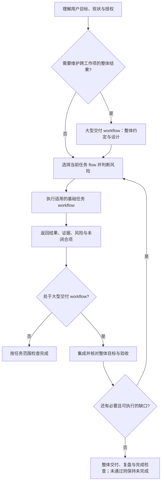

# 三部分结构与文件归属

## 问题定义与介绍开场

2026-10-11 与用户确认：介绍体系时，将核心工程问题归纳为三类，原六项问题作为下级展开。

| 主分类 | 具体问题 | 核心问题 |
| --- | --- | --- |
| 目标与验收不可靠 | 目标或必要链路遗漏、验收标准偏差、把局部成功误判为整体完成 | 要完成什么，凭什么判断完成？ |
| 上下文与执行状态不连续 | 中断或交接后丢失约定和进度、重复操作；规则与事实重复、过期或冲突 | 换会话、换 AI、换人后，依据什么继续，怎样保持前后一致？ |
| 方法改进缺少效果闭环 | 遇到问题不断加规则，缺少效果与成本评估，规则膨胀 | 方法是否真正改善结果，代价是否合理？ |

面试或项目介绍可用以下句子开场：

> 我在实践中主要遇到三类问题：一是目标和验收不可靠，二是上下文和执行状态不连续，三是方法改进缺少效果闭环。这套体系就是围绕这三类问题组织起来的。

对应的设计关注点是：完整目标、合理验收与基于证据的完成判断；权威事实、渐进加载与状态恢复；复盘后的条件改进以及效果与成本评估。这是问题与设计动机的归类，不表示所有机制的效果已得到验证。

### 开发连续性：可交接、可接续

上下文与执行状态的连续性，目标是支持**跨会话、跨 AI、跨人的开发接续**。开发依据应保存在可访问的项目资料与工程证据中，让接手者知道为什么这样做、目前做到哪里、哪些结果已验证，以及接下来该做什么，从已有有效成果继续。

- 有效上下文：目标、授权与约定、设计和决策依据。
- 执行状态：进度、证据、剩余缺口、下一动作与阻塞。
- 接手核对：当前代码与环境、资料适用性、已执行操作及其结果，避免盲目重复。

这是交接与接续的设计目标，不是宣称任意模型或人员都可无条件接手；资料可访问、权限与能力适配、现场核对仍是前提。资料角色与恢复入口见[工程产物与证据](artifact-traceability.md#核心定位)。

## 总体模型

这套 AI 开发体系按职责分为三部分：

| 部分 | 回答的问题 | 当前权威位置 |
| --- | --- | --- |
| 流程约束 | 任务走哪条路径、何时进入下一环节、什么条件算完成？ | `payload/AGENTS.shared.md` 的共享入口与 `payload/.agents/skills/development-lifecycle/SKILL.md` 的流程合同 |
| Skills | 当前环节或专项场景具体怎么做？ | `payload/.agents/skills/development-*` 的阶段 Skill，以及 `payload/.agents/wiki/skills/process/*` 的按需专项 Skill |
| Wiki | 做判断需要哪些已验证事实和多个 Skill 共享的信息？ | 本仓库 `wiki/` 的体系事实与共享信息；接入项目各自维护项目事实。安装布局中的 `.agents/wiki/knowledge` 可作为项目知识落点，但首版不预填项目事实 |

这是**职责拆分**，不要求目录名与三部分完全一一对应。`development-lifecycle` 在物理上是 Skill，语义上负责流程约束；一些专项 Skill 为了渐进加载放在 `.agents/wiki/skills/`，语义上仍属于 Skills。Wiki 中的事实与共享信息块不拥有阶段门或执行步骤。

## 流程如何使用三部分

1. 共享入口与 lifecycle 按任务性质选择 `initialization`、`standard`、`trivial` 或 `bugfix`，只指定当前需要的阶段。
2. 当前阶段的 Skill 执行方法；遇到治理、验收、知识维护、跨会话记录等场景，再加载对应专项 Skill。
3. Skill 按需读取目标项目的事实和共享信息块。项目愿景、授权、部署环境、架构现状不从本仓库复制到其他项目。
4. 交付前的复盘识别可复用增量，按[自动进化机制](evolution.md)回到原 owner 更新或不沉淀。

四种基础任务流程的准确顺序、阶段门与例外条件只在 `payload/.agents/skills/development-lifecycle/SKILL.md` 维护。官网的可视化是阅读概要，不是第二套流程合同。

### 贯穿三大模块：工程产物与证据

**体系由 Agent 工作流、Skills、Wiki 三大职责模块组成，并通过工程产物与证据，承载方案、执行状态和验证结果，支持追踪、恢复与可检验的交付。** 这是核心支撑：工作流组织推进与完成判断，Skills 指导产物的生成和使用，Wiki 保存从实践中沉淀的持续知识与项目事实。

Docs 中的设计、计划和验收合同承载方案与约定；日志和 current-state 承载过程与状态；测试结果、运行观察和 Review 结论提供对应范围的验证证据。文档存在不等于结果已获证明，也不能把所有产物都当成已经验证的事实。各类信息的作用与追踪方式由[工程产物与证据](artifact-traceability.md#核心定位)统一说明；这层支撑不另立流程规则 owner。

## Agent 工作流定位与介绍表达

2026-10-11 与用户确认的介绍表达：**擎天是一套 AI 驱动开发体系，围绕完整工程交付，组织覆盖工程迭代周期常规场景的多类型、多层级 Agent 工作流。**

这一定义包含两个重点：

1. **完整工程交付**：按请求范围，从理解目标推进到设计、实现、验证、交付和复盘，对必要结果与证据负责。
2. **多类型、多层级 Agent 工作流**：不同性质的工程工作使用对应工作流；上层工作流组织下层工作流，接收结果与证据，维护整体目标并完成集成验收。

介绍体系时，可以从两个不同维度展开：

| 维度 | 拆分方式 | 回答的问题 |
| --- | --- | --- |
| 工作流的覆盖与组织 | 多类型：初始化、标准需求开发、简单修改、缺陷修复；多层级：大型交付组合基础任务工作流 | 覆盖哪些常规工程场景，如何组织完整交付？ |
| 体系的模块与职责 | Agent 工作流、Skills、Wiki | 推进过程、执行方法和项目事实分别由谁负责？ |

第二个维度的三大模块可口述为：**Agent 工作流组织推进过程与完成判断，Skills 提供当前环节的具体方法，Wiki 提供判断所需的知识与项目事实。** 这里的“Agent 工作流”对应总体模型中“流程约束”所组织的工作过程；底层规则 owner 仍是共享入口与 Lifecycle。两种拆分可以同时成立：每一种工作流都会按需调用 Skills、读取 Wiki，Skills 与 Wiki 为不同类型和层级的工作流提供支持。

这里的 Agent 工作流是由 Agent 执行、围绕结果组织的工程工作过程，具有目标、阶段、验收条件和完成判断，比单个 action 或工具调用具有更完整的语义。“多类型”对应初始化、标准需求开发、简单修改和缺陷修复；“多层级”对应大型交付对基础任务工作流的嵌套与组合。设计、实现、验证等是工作流内部的阶段，由对应 Skills 提供方法，不额外计为同层级工作流。

介绍时可直接说：

> 我构建的 AI 驱动开发体系有两个重点：完整工程交付，以及覆盖工程迭代周期常规场景的多层级 Agent 工作流。针对初始化、功能开发、简单修改和缺陷修复等不同工作，选择对应流程；大型交付再组合这些流程，持续维护整体目标，接收各项结果与证据并完成集成验收。

“覆盖常规场景”描述现有方法的适用范围，不宣称穷尽所有工程活动或所有场景均已验证。Agent 工作流也不意味着多 Agent 协作；当前嵌套主要由方法合同与 Lifecycle 路由表达，强制执行与持续调度能力仍取决于宿主。

## Workflow 的层次与嵌套

显式入口在[Workflow 目录](../payload/.agents/workflows/README.md)，大型交付正文在[major-delivery.md](../payload/.agents/workflows/major-delivery.md)。安装后保留相同 `.agents/workflows/` 路径；官网也提供[在线流程目录](/workflows/README.md)与[大型交付正文](/workflows/major-delivery.md)。

Workflow 表示围绕某个结果组织的完整工作过程。当前体系既有具体工作项的基础任务 workflow，也有维护整体结果的大型交付 workflow；介绍工作流时应同时列出两层，不能把四个 `flow` 值当成全部 workflow。

| 层级 | Workflow | 负责的结果 |
| --- | --- | --- |
| 基础任务 | initialization、standard、trivial、bugfix | 当前具体工作项的理解、设计、实现、验证、交付与复盘，按适用路径执行 |
| 整体交付 | 大型交付（major delivery） | 整体目标与有效约定、工作项选择、依赖与集成、持续推进与恢复、整体验收和交付 |

输入后先理解目标、现状、授权和关键未知：需要跨工作项或上下文持续承担完整成果时进入大型交付 workflow；每个当前工作项再按性质选择基础任务 `flow`，风险独立判断。普通单项任务直接使用基础任务 workflow。两层判断是组合关系，不是五个平级分支互相排斥。

这里的嵌套意味着外层拥有整体责任，内层拥有具体执行结果；内层完成只关闭对应子目标，须携证据回到外层。工作项排序或必要分阶段不降低原目标，不能以子流程结束或局部发布关闭整体交付。现有载体仍为 `delivery-mode: major` 与当前工作项的 `flow`，不需要增加第五个基础 `flow` 或第二个 Lifecycle。

这张图解释现有方法，不表示已经实现强制执行的嵌套工作流引擎、任意深度递归或后台调度。流程路径由 `.agents/workflows/` 中的对应文件拥有，阶段调度与整体完成仍由原 Lifecycle 拥有。

## 大型交付 Workflow（试用）

当用户委托完整的大型成果，需要跨工作项或上下文持续维护结果时，lifecycle 按需加载 `.agents/workflows/major-delivery.md`；旧 `references/major-delivery.md` 只作兼容跳转。大型交付 workflow 负责整体推进，并嵌套、组合四种基础任务 workflow；默认一个交付阶段，必要拆分由验收合同给出依据，不新增第二个 Meta Skill。

外层过程是：建立整体目标与有效验收约定 → 整体及当前部分设计 → 选择并推进工作项 → 集成验证与整体缺口核对 → 继续必要工作或明确真实阻塞 → 整体交付、复盘与完成检查。具体阶段门复用原方法，不另抄一套合同。

已有验收合同拥有有效约定与显式修订，并引用日志中的原始输入；工作记录方法中的 `references/major-delivery-records.md` 拥有恢复入口、原始输入记录、持续日志和轻量模板。每部分书面方案明确来源对齐，设计、Review、验证各保留原职责，普通小任务不加载整套大型交付材料。宿主停止后是否能继续执行仍取决于宿主；真实收益待试用。

## 当前 Skill 组合

- **阶段 Skill**：`development-task-understanding`、`development-design`、`development-implementation`、`development-validation`、`development-review`、`development-delivery`、`development-retrospective`。它们由 lifecycle 在相应环节路由。
- **专项 Skill**：当前共享包中的 `agent-instructions-governance`、`acceptance-contract-governance`、`project-knowledge-governance`、`iteration-work-notes`、`iterative-quality-convergence`。项目还可以维护自己的产品、技术栈或发布专项 Skill，不回写到共享包中的通用 owner。

现有文件与分发边界见[当前实现事实](current-state.md)。新增长期信息时，先判断它是流程约束、执行方法还是事实/共享信息，再修改对应 owner；不要在 `AGENTS.md`、多个 Skill 和 Wiki 中平行维护同一规则。
