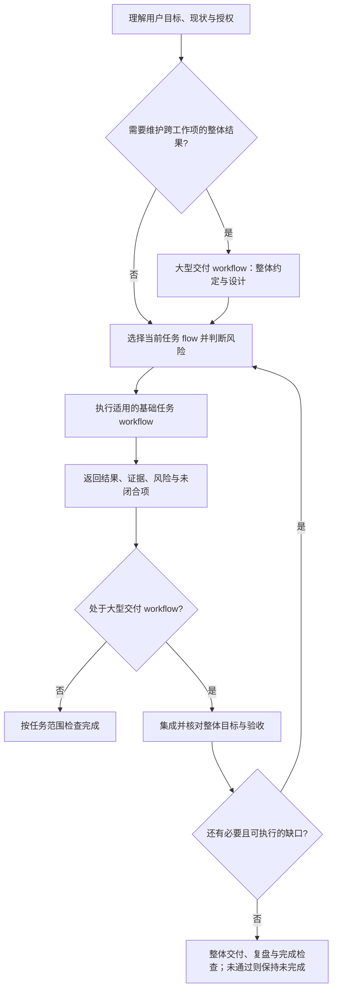

# 三层架构与文件归属

本文描述擎天内部的三层职责；整体定位是建设在 Codex、Claude Code 等现成编码 Agent 之上的开发体系。与宿主的分工及建设范围以[愿景主线与定位边界](vision.md#定位边界建设在现成编码-agent-之上的开发体系)为准。

## 问题定义与介绍开场

2026-10-11 与用户确认：介绍体系时，将核心工程问题归纳为三类，原六项问题作为下级展开。

| 主分类 | 具体问题 | 核心问题 |
| --- | --- | --- |
| 目标与验收不可靠 | 目标或必要链路遗漏、验收标准偏差、把局部成功误判为整体完成 | 要完成什么，凭什么判断完成？ |
| 上下文与执行状态不连续 | 中断或交接后丢失约定和进度、重复操作；规则与事实重复、过期或冲突 | 换会话、换 AI、换人后，依据什么继续，怎样保持前后一致？ |
| 方法改进缺少效果闭环 | 遇到问题不断加规则，缺少效果与成本评估，规则膨胀 | 方法是否真正改善结果，代价是否合理？ |

面试或项目介绍可用以下句子开场：

> 我在实践中主要遇到三类问题：一是目标和验收不可靠，二是上下文和执行状态不连续，三是方法改进缺少效果闭环。这套体系就是围绕这三类问题组织起来的。

对应的设计关注点是：完整目标、合理验收与基于证据的完成判断；权威事实、渐进加载与状态恢复；复盘后的条件改进以及效果与成本评估。这是问题与设计动机的归类，不表示所有机制的效果已得到验证。

### 开发连续性：可交接、可接续

上下文与执行状态的连续性，目标是支持**跨会话、跨 AI、跨人的开发接续**。开发依据应保存在可访问的项目资料与工程证据中，让接手者知道为什么这样做、目前做到哪里、哪些结果已验证，以及接下来该做什么，从已有有效成果继续。

- 有效上下文：目标、授权与约定、设计和决策依据。
- 执行状态：进度、证据、剩余缺口、下一动作与阻塞。
- 接手核对：当前代码与环境、资料适用性、已执行操作及其结果，避免盲目重复。

这是交接与接续的设计目标，不是宣称任意模型或人员都可无条件接手；资料可访问、权限与能力适配、现场核对仍是前提。资料角色与恢复入口见[工程产物与证据](artifact-traceability.md#核心定位)。

## 总体模型：三层架构

2026-10-11 用户确认以三层架构组织体系论述：**工作流层 → 方法层 → 知识与任务资料层**。此前的流程约束、Skills、Wiki 是职责拆分；现在将 Wiki 与任务约定、工作记录、验证证据共同放入底层，完整呈现执行依据与结果。

### 架构内容树（按已确认原文保存）

```text
AI 驱动开发体系
│
├── 上层：工作流层——组织工程过程
│   ├── 基础工作流：初始化、标准需求开发、简单修改、缺陷修复
│   ├── 大型交付：组合基础工作流，维护整体成果
│   └── 流程控制：阶段推进、返工与完成判断
│
├── 中层：方法层——Skills
│   ├── 执行方法：理解、设计、实现、验证、Review 等
│   ├── 行为约束：执行时必须遵循的方法与质量要求
│   └── 专项方法：验收治理、知识治理、工作记录等
│
└── 底层：知识与任务资料层——支撑判断、执行与接续
    ├── 项目知识：Wiki
    │   └── 环境、架构、既有行为、稳定知识与决策
    ├── 任务约定与方案
    │   ├── 任务目标、需求、范围与边界
    │   ├── 验收合同：当前有效要求与成功标准
    │   └── 设计与计划：实现方案、取舍与执行安排
    ├── 工作记录与状态
    │   ├── 日志：原始输入、过程变化与执行历史
    │   └── 当前状态：进度、剩余缺口、下一动作与阻塞
    └── 验证证据
        └── 测试结果、实际运行观察、Review 与验收结论
```

### 讲述时展开到工作流步骤

官网内容树支持“工作流层 → 基础工作流 → 具体流程 → 编号步骤”，大型交付则直接展开外层循环；还可展开每个流程的适用场景与流程门。顺序来自 `payload/.agents/workflows/` 的权威正文，构建时自动生成官网节点，不另立一份流程合同。

| 具体流程 | 步骤数 | 讲述重点 |
| --- | --- | --- |
| [项目初始化](../payload/.agents/workflows/initialization.md) | 8 | 从目标和技术栈设计，到最小完整项目、首条真实运行链路及交付复盘 |
| [标准需求开发](../payload/.agents/workflows/standard.md) | 8 | 理解、设计、方案审查、实现、AI 验收验证、实现审查、用户验收交付、复盘 |
| [简单改动](../payload/.agents/workflows/trivial.md) | 5 | 低风险短路径；发现设计分叉或跨层影响时升级标准需求开发 |
| [问题修复](../payload/.agents/workflows/bugfix.md) | 8 | 先预期、复现和根因，再修复判定与必要设计，最后验证原触发和相邻行为 |
| [大型交付（试用）](../payload/.agents/workflows/major-delivery.md) | 7 | 维护整体约定，选择并执行基础工作流，接收结果、集成验证、持续补齐整体缺口 |

这些数字用于说明当前概要，不增加阶段；条件设计门、返工、适用用户验收与完成判断以对应流程和 Lifecycle 为准。节点连线表达归属，步骤编号表达先后；大型交付的持续推进包含循环。

### 总览口述

> 我把体系分成三层：上层用工作流组织完整工程过程，中层用 Skills 提供执行方法和行为约束，底层用项目知识、任务约定与方案、工作记录和验证证据支撑执行。这样既能明确怎样推进，也能让换会话、换 AI 或换人之后继续开发。

### 两种约束的区分

| 约束 | 回答的问题 | 例子 |
| --- | --- | --- |
| 方法与行为约束 | 做事时应遵循什么方法？ | 实现前审查方案，验证时检查真实行为 |
| 任务约束 | 这次具体要做成什么、满足什么条件？ | 刷新后能恢复任务，恢复时不能重复提交 |

任务约束归入“任务约定与方案”，不能与 Skills 中的方法约束混为一谈；任务中的授权与有效约定也不能被通用方法覆盖。

### 职责、依赖与文件归属

| 层 | 职责 | 当前权威位置 |
| --- | --- | --- |
| 工作流层 | 组织任务路径、阶段门、返工与完成判断 | `payload/AGENTS.shared.md`、`payload/.agents/workflows/` 与 `development-lifecycle` |
| 方法层 | 提供阶段/专项方法与行为约束 | `payload/.agents/skills/development-*` 与 `.agents/wiki/skills/process/*` |
| 知识与任务资料层 | 提供项目事实、任务约定、方案、执行状态与验证证据 | 项目 Wiki、Docs、原始资料与证据附件；角色与命名见[工程产物与证据](artifact-traceability.md) |

**这是职责与依赖的分层，不是严格的单向调用结构。** 工作流可以直接读取任务状态和证据，Skills 也会读写底层资料；底层既提供执行依据，也接收执行产生的结果。Wiki 只是底层的一部分，不把所有 Docs 改称 Wiki。文件位置不等于职责：Lifecycle 物理上是 Skill，语义上组织工作流；Wiki 目录中的专项 Skill 仍属于方法层。分层不新增规则 owner、目录迁移或独立工作流引擎。

## 三层如何协同

1. 工作流层按任务性质选路径，由 Lifecycle 调度当前阶段并检查完成门。
2. 方法层按需加载当前阶段与专项 Skills，读取底层项目事实、任务约定和设计。
3. 执行中形成或更新方案、工作记录与证据；恢复或交接时核对这些资料及实际现场。
4. 验证与 Review 检查证据及产物；复盘把可复用事实回 Wiki，把方法改进回原 Skill 或流程 owner。

文档存在不等于结果已获证明；四种基础工作流的顺序与阶段门仍由原合同拥有。官网图是阅读概要。产物的角色、命名和证据范围见[工程产物与证据](artifact-traceability.md)。

## Agent 工作流定位与介绍表达

2026-10-11 与用户确认的介绍表达：**擎天是一套 AI 驱动开发体系，围绕完整工程交付，组织覆盖工程迭代周期常规场景的多类型、多层级 Agent 工作流。**

这一定义包含两个重点：

1. **完整工程交付**：按请求范围，从理解目标推进到设计、实现、验证、交付和复盘，对必要结果与证据负责。
2. **多类型、多层级 Agent 工作流**：不同性质的工程工作使用对应工作流；上层工作流组织下层工作流，接收结果与证据，维护整体目标并完成集成验收。

介绍体系时，可以从两个不同维度展开：

| 维度 | 拆分方式 | 回答的问题 |
| --- | --- | --- |
| 工作流的覆盖与组织 | 多类型：初始化、标准需求开发、简单修改、缺陷修复；多层级：大型交付组合基础任务工作流 | 覆盖哪些常规工程场景，如何组织完整交付？ |
| 体系的分层与职责 | 工作流层、方法层、知识与任务资料层 | 工程过程、方法约束、执行依据与证据如何协同？ |

第二个维度采用上述三层架构；工作流维度中的每一类路径都会使用方法层，并读写底层知识与任务资料。工作流的嵌套层级与架构职责的三层是不同维度。

这里的 Agent 工作流是由 Agent 执行、围绕结果组织的工程工作过程，具有目标、阶段、验收条件和完成判断，比单个 action 或工具调用具有更完整的语义。“多类型”对应初始化、标准需求开发、简单修改和缺陷修复；“多层级”对应大型交付对基础任务工作流的嵌套与组合。设计、实现、验证等是工作流内部的阶段，由对应 Skills 提供方法，不额外计为同层级工作流。

介绍时可直接说：

> 我构建的 AI 驱动开发体系有两个重点：完整工程交付，以及覆盖工程迭代周期常规场景的多层级 Agent 工作流。针对初始化、功能开发、简单修改和缺陷修复等不同工作，选择对应流程；大型交付再组合这些流程，持续维护整体目标，接收各项结果与证据并完成集成验收。

“覆盖常规场景”描述现有方法的适用范围，不宣称穷尽所有工程活动或所有场景均已验证。Agent 工作流也不意味着多 Agent 协作；当前嵌套主要由方法合同与 Lifecycle 路由表达，强制执行与持续调度能力仍取决于宿主。

## Workflow 的层次与嵌套

显式入口在[Workflow 目录](../payload/.agents/workflows/README.md)，大型交付正文在[major-delivery.md](../payload/.agents/workflows/major-delivery.md)。安装后保留相同 `.agents/workflows/` 路径；官网也提供[在线流程目录](/workflows/README.md)与[大型交付正文](/workflows/major-delivery.md)。

Workflow 表示围绕某个结果组织的完整工作过程。当前体系既有具体工作项的基础任务 workflow，也有维护整体结果的大型交付 workflow；介绍工作流时应同时列出两层，不能把四个 `flow` 值当成全部 workflow。

| 层级 | Workflow | 负责的结果 |
| --- | --- | --- |
| 基础任务 | initialization、standard、trivial、bugfix | 当前具体工作项的理解、设计、实现、验证、交付与复盘，按适用路径执行 |
| 整体交付 | 大型交付（major delivery） | 整体目标与有效约定、工作项选择、依赖与集成、持续推进与恢复、整体验收和交付 |

输入后先理解目标、现状、授权和关键未知：需要跨工作项或上下文持续承担完整成果时进入大型交付 workflow；每个当前工作项再按性质选择基础任务 `flow`，风险独立判断。普通单项任务直接使用基础任务 workflow。两层判断是组合关系，不是五个平级分支互相排斥。



这里的嵌套意味着外层拥有整体责任，内层拥有具体执行结果；内层完成只关闭对应子目标，须携证据回到外层。工作项排序或必要分阶段不降低原目标，不能以子流程结束或局部发布关闭整体交付。现有载体仍为 `delivery-mode: major` 与当前工作项的 `flow`，不需要增加第五个基础 `flow` 或第二个 Lifecycle。

这张图解释现有方法，不表示已经实现强制执行的嵌套工作流引擎、任意深度递归或后台调度。流程路径由 `.agents/workflows/` 中的对应文件拥有，阶段调度与整体完成仍由原 Lifecycle 拥有。

## 大型交付 Workflow（试用）

当用户委托完整的大型成果，需要跨工作项或上下文持续维护结果时，lifecycle 按需加载 `.agents/workflows/major-delivery.md`。大型交付 workflow 负责整体推进，并嵌套、组合四种基础任务 workflow；默认一个交付阶段，必要拆分由验收合同给出依据，不新增第二个 Meta Skill。

外层过程是：建立整体目标与有效验收约定 → 整体及当前部分设计 → 选择并推进工作项 → 集成验证与整体缺口核对 → 继续必要工作或明确真实阻塞 → 整体交付、复盘与完成检查。具体阶段门复用原方法，不另抄一套合同。

已有验收合同拥有有效约定与显式修订，并引用日志中的原始输入；工作记录方法中的 `references/major-delivery-records.md` 拥有恢复入口、原始输入记录、持续日志及delivery-goals功能/任务清单及逐项验收模板。每部分书面方案明确来源对齐，设计、Review、验证各保留原职责，普通小任务不加载整套大型交付材料。宿主停止后是否能继续执行仍取决于宿主；真实收益待试用。

## 当前 Skill 组合

- **阶段 Skill**：`development-task-understanding`、`development-design`、`development-implementation`、`development-validation`、`development-review`、`development-delivery`、`development-retrospective`。它们由 lifecycle 在相应环节路由。
- **专项 Skill**：当前共享包中的 `agent-instructions-governance`、`acceptance-contract-governance`、`project-knowledge-governance`、`iteration-work-notes`、`iterative-quality-convergence`。项目还可以维护自己的产品、技术栈或发布专项 Skill，不回写到共享包中的通用 owner。

现有文件与分发边界见[当前实现事实](current-state.md)。新增长期信息时，先判断它是流程约束、执行方法还是事实/共享信息，再修改对应 owner；不要在 `AGENTS.md`、多个 Skill 和 Wiki 中平行维护同一规则。
